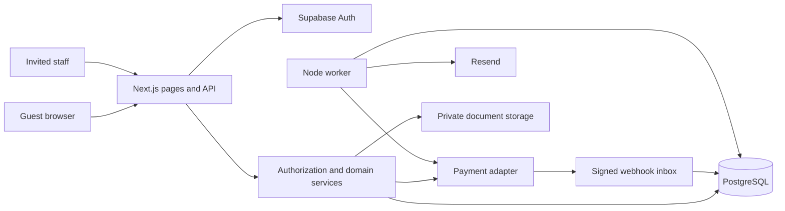
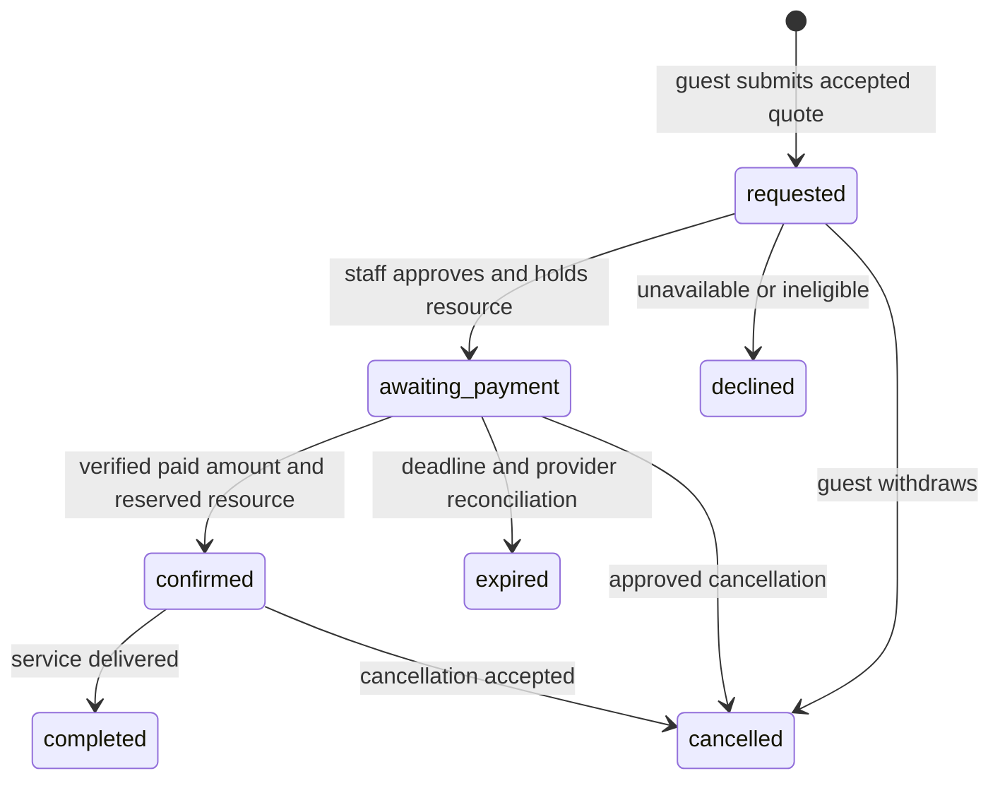

# Architecture: independent Morocco travel booking service

Date: 2026-10-20. Inputs: [recon.md](recon.md), [features.csv](features.csv). Output is a proposed architecture and first SQL migration, not a deployed application. All choices below are for the independent product; they do not describe Marhire's private implementation.

## Decisions and release boundary

Start with **cars, one operating organization, guest reservations, supplier approval before payment, and support-assisted changes**. Model other categories now, then enable their booking forms after the car loop works. An operations workspace is a new requirement for running the service, not an observed Marhire screen.

Use an internal provisional name until `$replica-brand` establishes an independent identity. English is the first complete locale; prepare French and Arabic routes and RTL components without publishing unreviewed translations. No native app, subscriptions, marketplace payouts, customer account requirement, public review import, live flight API or multi-item cart in the first release.

A click on the final guest form creates a **reservation request**, not a confirmed booking. Staff verify the supplier and resource, accept the quoted conditions or issue a revised quote for customer acceptance, then provide a payment link. Confirmation requires verified payment and reserved inventory. No request may silently become a more expensive booking.

## Stack

| Layer | Choice | Reason |
| --- | --- | --- |
| Web/API | Next.js App Router + TypeScript on a supported Node LTS | Server-rendered catalog and route handlers in one application; interactive booking controls remain small client components ([Next.js](https://nextjs.org/docs/app/getting-started/server-and-client-components)) |
| Styling | Tailwind and original tokens from replica-design | Shared responsive components with English/French/Arabic typography and keyboard support |
| Database | Supabase-managed PostgreSQL; one database and private `app` schema | Transactions, tenant isolation, range exclusion and future Auth/Storage reuse |
| Database access | Drizzle + node-postgres; SQL migrations authoritative for exclusion/RLS/triggers | Typed queries while retaining Postgres invariants; [Drizzle PostgreSQL guide](https://orm.drizzle.team/docs/get-started/postgresql-new) |
| Authentication | Supabase Auth for invited staff; no guest signup | Verify server session and active membership per request; MFA for privileged staff before production. Supabase documents cookie-based SSR integration ([SSR guide](https://supabase.com/docs/guides/auth/server-side)) |
| Guest access | Random opaque booking tokens exchanged for scoped HttpOnly cookies | No password or enumeration by booking reference/email; hashes only in DB |
| Payments | Provider adapter; Stripe Checkout for eligible merchant/test environments | One-time hosted checkout fits reservation prepayment. Morocco is absent from [Stripe's supported-country list](https://stripe.com/global), so do not assume a Morocco-only business can open an account. Local acquiring provider selection remains open |
| Email | Resend with verified sender domain | Transactional request, payment-link and confirmation emails; domain setup is required ([domain docs](https://resend.com/docs/dashboard/domains/introduction)) |
| Background jobs | Separate Node worker from the same repo, Postgres inbox/outbox and leases | Durable retries without a second queue database; no in-process fire-and-forget jobs |
| Files | Supabase Storage; private RC quarantine/documents, separate licensed catalog media | Signed short-lived document access and explicit bucket policies ([storage access control](https://supabase.com/docs/guides/storage/security/access-control)) |
| Hosting | Render Node web service + background worker, placed near Supabase | Simple persistent runtimes with a separate worker lifecycle; official [Next.js deployment](https://render.com/docs/deploy-nextjs-app) and [worker support](https://render.com/docs/background-workers) |
| Verification | Vitest for money/state rules; Playwright for complete flows; PostgreSQL integration tests | Target the transactional risks and guest/staff access boundaries |

No cloud accounts, projects, subscriptions or paid resources have been provisioned. No price quote or free-tier sufficiency is assumed. Production sizing and regional availability must be checked when the user's hosting and merchant accounts are known. Pin exact package versions and commit a lockfile during scaffolding.

Use a small connection pool per web/worker process. For a persistent IPv4-only host, Supabase documents its session pooler; direct connections depend on network support. Take endpoints from the user's dashboard, not guessed hostnames. Use a separate migration connection and runtime login ([connection guide](https://supabase.com/docs/guides/database/connecting-to-postgres)).

## Runtime boundaries

Suggested modules: `catalog`, `pricing`, `eligibility`, `inventory`, `reservations`, `payments`, `support`, `partners`, `content`, `authz`, `jobs`. Browser code receives public DTOs only. Business transitions run in services used by route handlers and jobs, with transactional DB access in repositories. No microservices or realtime infrastructure is needed.

## Schema and ownership

See [schema.sql](schema.sql): **25 application tables**. UUID primary keys, creation/update timestamps, explicit deletion rules, tenant ownership and indexed foreign keys are included. UUIDs are identifiers, never authorization credentials. Datetimes are `timestamptz`; the original local zone is retained where relevant. Birth dates are calendar dates represented in validated traveler JSON as `YYYY-MM-DD`, not instants.

| Area | Tables | Purpose and access |
| --- | --- | --- |
| Ownership | organizations, memberships | One business now; staff subjects reference Supabase Auth IDs logically. Only owners manage membership through trusted provisioning initially |
| Supply/catalog | cities, suppliers, listings, listing_media, listing_options | Own verified suppliers and licensed media. Public API projects published fields; supplier contacts stay private |
| Pricing | protection_plans, addons, coupons, quotes | Integer EUR cents, explicit rules, short-lived immutable quotes. Coupon limits are enforced transactionally when approving/holding a booking |
| Inventory | resources, allocations | Concrete cars or equivalent exclusive resources; held/reserved/maintenance intervals cannot overlap |
| Reservations | bookings, booking_access_tokens | Guest PII and immutable accepted price/trip/policy snapshots; tokens expire and can be revoked |
| Money | payment_attempts, refunds, webhook_events | Separate payment lifecycle from booking lifecycle; signed inbox deduplication and refund ceilings |
| Assistance | support_requests | Questions and timestamped change/cancel requests; binding deadline is receive time |
| Partner intake | partner_applications, document_files | Verification workflow and quarantined private RC uploads |
| Content/privacy | content_pages, consent_records | Original localized policy/content revisions and purpose-specific consent evidence |
| Reliability | outbox_events, audit_events | Transactional notifications/jobs, staff action trace with redacted payloads |

Deliberate reductions from the recon concepts: category is a constrained code; guest details are per-booking JSON rather than a cross-booking identity profile; quote lines/add-on selections are immutable snapshots. More normalized guest profiles or inventory slot-capacity tables can be added when requirements justify them.

Every tenant child foreign key includes `org_id`, preventing cross-business references. Catalog dependencies and financial records use RESTRICT; disposable child media or access tokens use CASCADE. Historical suppliers/listings are archived, not deleted out from under bookings. Database timestamps update through a trigger. Auth user deletion disables/removes membership through a controlled process; no physical Auth-schema foreign key is assumed.

### Authorization

Database RLS is enabled on all 25 tables. The dedicated `app_runtime` role is nonowner and has no BYPASSRLS. Every repository operation runs inside a transaction with `set_config('app.org_id', verifiedOrgId, true)`. The policy only permits that tenant. Pool connections must never retain tenant settings outside a transaction. The migration owner is not a runtime credential. The `app` schema must remain outside Supabase's exposed Data API schemas; no browser database grants or service-role secret in client code.

RLS is the tenant boundary; **the application data layer must also authorize each query/action within that tenant**. It derives organization from an allowlisted host/config or verified staff membership, never a client-supplied `org_id`. Custom session variables are trusted server context, not authentication by themselves. A missing tenant context returns no rows. Job workers process one trusted organization context per transaction.

| Principal | Allowed | Denied |
| --- | --- | --- |
| Public visitor | Published catalog/content DTOs, rate-limited quote/request/contact/application creation | Direct DB access, supplier contacts, guest records, internal status lists |
| Quote session | Its own quote IDs via signed/random session cookie hash | Another session's quote, client-controlled price/tax/eligibility claims |
| Booking guest | One booking's safe DTO, checkout and change/cancel requests after valid token exchange | Other reservations, staff notes, RC docs, arbitrary price/status edits |
| Support staff | Assigned-org support queue and minimal booking/contact information | Refund execution, pricing publication, memberships and unnecessary DOB/document access |
| Operations | Supplier/resource allocation, request approval/decline, completion, approved change processing | Membership changes and refund execution |
| Finance | Payment/refund reconciliation and approved refund execution | Supplier document approval and role administration |
| Owner | All business actions, staff provisioning and policy publication | Any cross-org record |
| Webhook/job | Specific signed/leased event operations | Treating arbitrary metadata or a return-page URL as paid confirmation |

Guest links use at least 32 random bytes; store SHA-256 token hashes, expiry, purpose and revocation. Put exchange tokens in the URL fragment, then POST them for one-time exchange into a short-lived HttpOnly Secure SameSite cookie. Serve the exchange page with no analytics/third-party content and `Referrer-Policy: no-referrer`. Link previews must not consume a token on GET. A booking reference or email address is insufficient. Renew access by email with an indistinguishable response and rate limit; test email delivery and token leakage protection.

### Pricing and domain invariants

- Server computes every quote from published listing rules, dates, return city, selected coverage, extras, coupon and tax configuration. Browser totals are advisory. Quotes expire after 15 minutes by default and include rules and policy versions; staff approval revalidates them. Changing a quote creates a new ID. One quote can create only one booking.
- MVP currency is EUR throughout. Decimal display uses cents; arithmetic uses integers with documented rounding. Rental days initially use ceiling(elapsed seconds / 86400), with minimum one; show the charged duration. This is a proposed business choice, not a claim about every reference rental. Product owner must choose elapsed duration versus local-day billing before live launch.
- Require positive prepayment for the paid booking flow. Security deposit at pickup is separate from total and advance payment. Exact prepayment percentage, tax treatment, one-way fees, mileage and cancellation rules are configurable owned policies; do not seed conflicting reference values or advertise coverage without supplier agreement.
- Initially leave protection unselected and require an explicit choice; show final cost, excess, security deposit and age condition. Validate the driver's age on pickup date and licence tenure, separately from an adult booker's age. Add driver's DOB/licence-issued date and a different-driver option to the new product form when booker and driver differ. Do not claim these extra fields were observed in recon.
- Quote configuration uses versioned runtime schemas per category. Reject unknown IDs, inactive plans, options/add-ons for another listing, exceeded add-on maximums, missing addresses, invalid dates and unsafe passenger/luggage counts. Quote FK constraints bind selected option/plan to the listing; JSON shape/eligibility rules belong in the domain service.
- Physical resources are separate from catalog cards. Before payment, staff select an active resource from the verified supplier, check class/model/plan suitability and confirm any substitute with the guest. Allocate maintenance and turnaround time in the same resource calendar. The SQL uses `[start,end)` ranges, allowing adjacent intervals; operational buffer is included in the allocation interval.
- PostgreSQL exclusion rejects overlapping active intervals, including concurrent inserts ([range constraints](https://www.postgresql.org/docs/current/rangetypes.html)). An expired timestamp alone does not remove a hold: explicitly transition to released under locks, then allocate. Shared boat/activity seats require a later capacity-ledger migration; initial support is exclusive/private capacity only.
- Refund rows lock the payment parent and reject amounts exceeding captured funds net of other pending/successful refunds. All payment/refund operations for a booking use a consistent booking-then-payment lock order. Terminal ledger rows and references must not be reassigned by application code. Schema constraints complement, rather than replace, transition services.

### Reservation and payment sequence

Money has its own states: attempt creating/pending/succeeded/failed/expired; refund requested/pending/succeeded/failed. A cancelled booking can still need reconciliation/refund. A failed late webhook cannot turn a successful payment back into pending or failed.

1. `POST /api/bookings`: lock/revalidate quote, session ownership and eligibility, store accepted snapshots and consent, create requested booking, and enqueue acknowledgment in the same transaction. Acknowledge request only. Repeated idempotency key with identical input returns the same result; changed input yields 409.
2. Staff approval: lock booking, verify resource and approved quote, obtain any needed customer acceptance, release old expired holds, create nonoverlapping hold, set payment deadline and transition to awaiting_payment. Enqueue payment-link email. Default deadline is 60 minutes, configurable within the selected processor's supported session limits.
3. Checkout: under booking lock, require guest authorization, awaiting_payment, unexpired hold and accepted quote; persist one creating attempt and provider idempotency key. Commit before external network call, create provider session from server amount/currency, then attach session ID in a second transaction. If the process crashes, retry/reconciliation recovers the same session. Do not hold DB locks across provider calls.
4. Webhook: verify signature using raw body, map endpoint to the trusted provider account/org, validate object/session/account/amount/currency, persist unique event ID, acknowledge promptly, and process via worker. Re-query provider payment status when needed; neither browser redirect nor `completed` event name alone establishes paid status. [Stripe's fulfillment guide](https://docs.stripe.com/checkout/fulfillment.md?payment-ui=stripe-hosted) requires reliable server fulfillment and distinguishes delayed payment outcomes.
5. Payment reconciliation: lock booking and attempt; record verified receipt exactly once. If approval and hold still apply, change allocation to reserved, then booking to confirmed, with a deduplicated confirmation outbox entry. A database trigger rejects confirmation without supplier approval, sufficient net prepayment and reserved time coverage.
6. Expiry: initiate checkout expiration where supported, reconcile provider state, then release inventory and mark booking expired. If a late payment arrives after release, record its actual successful receipt, keep the booking unconfirmed, open an exception and enqueue a full refund. Never discard the receipt or confirm an already-reallocated car. Disable delayed-success payment methods for initial launch; still handle unexpected delayed events.
7. Cancellation/change: store request before response; use the accepted policy snapshot and server timestamp. Staff approval cancels or proposes a replacement quote. Cancellation and inventory release/outbox creation are atomic; refund execution is asynchronous. A change retains the old booking until the replacement allocation/price and guest acceptance can be committed; otherwise leave the original unchanged. No freeform PATCH of booking state, price or dates.

## API contracts

These are **new product routes**, not copied reference endpoints. JSON input validated server-side; mutations check origin/CSRF for cookie sessions, include request IDs, enforce tenant and object authorization, and reject caller-supplied monetary totals. Standard errors: 400 invalid input, 401/403 access, 404 unavailable object without cross-tenant leakage, 409 state/price conflict, 422 eligibility, 429 throttling, 503 provider retry. Pagination uses a stable cursor and ID tie-breaker. Cached data contains no guest/private fields.

### F01 — discover cars

| ID / method path | What it does | Who | Input | Output |
| --- | --- | --- | --- | --- |
| A01 GET `/api/catalog` | Filter/sort published offers for category/city/date scope | Public | category, city, type, brand, fuel, transmission, min/max cents, dates, sort, cursor | Public listing DTOs, matched count, next cursor; availability described as request-based |
| A02 GET `/api/listings/:slug` | Detail/options/plans and owned media | Public | slug, locale | Published detail DTO with rule versions |
| A03 GET `/api/content/:kind/:slug` | Policy/FAQ/landing/editorial revision | Public | kind, slug, locale | Published content and revision |

### F02 — reserve car

| ID / method path | What it does | Who | Input | Output |
| --- | --- | --- | --- | --- |
| A04 POST `/api/quotes` | Validate trip and calculate immutable expiring quote | Guest quote session | listing/options/plan/extras, dates, locations, driver eligibility, coupon | quote ID, itemized cents, policy/rule versions, expiry, session binding |
| A05 POST `/api/bookings` | Save request against accepted quote | Same quote session | quote ID, guest/driver details, acknowledgments, idempotency key | Request reference/state, scoped guest session; no payment/confirmation claim |
| A06 POST `/api/bookings/:reference/checkout` | Create/reuse approved payment attempt | Booking guest | idempotency key | Hosted provider URL and expiry or state conflict |
| A07 GET `/api/bookings/:reference` | Safe status/receipt/pickup summary | Booking guest or authorized staff | reference | Safe booking DTO; pending state if webhook not processed |
| A08 POST `/api/booking-access/exchange` | Consume one-use email token, set session cookie | Token holder | opaque fragment token | 204 and scoped cookie |

### F03 — private driver

Reuse A01/A02/A04/A05/A06/A07 with `category=driver` and a separate input schema: airport/intercity, service date/time, route/addresses, passenger/luggage counts and optional flight. Quote is estimated until staff finalizes route; a changed final amount creates a new quote and acceptance request. No additional endpoints or invented reference results URL.

### F04 — boat booking

Reuse A01/A02/A04/A05/A06/A07 with `category=boat`, option/duration, start time and guest count. Only exclusive/private bookings initially. Require captain/operator availability and capacity approval; do not treat guest count as reservable shared stock.

### F05 — activity booking

Reuse A01/A02/A04/A05/A06/A07 with `category=activity`, option, date/time preference, participants and pickup details. Staff resolve flexible preference to a concrete accepted start/end before payment. Shared sessions are deferred until capacity constraints exist.

### F06 — support

| ID / method path | What it does | Who | Input | Output |
| --- | --- | --- | --- | --- |
| A09 POST `/api/support-requests` | Persist general question and enqueue acknowledgment | Public; guest for linked booking | contact, message, privacy revision, idempotency key | Request ID and received timestamp |

### F07 — changes and cancellation

| ID / method path | What it does | Who | Input | Output |
| --- | --- | --- | --- | --- |
| A10 POST `/api/bookings/:reference/requests` | Persist authenticated change/cancel request | Booking guest | kind, proposed change, reason, idempotency key | Request ID, binding received time, pending-review status |
| A11 POST `/api/bookings/access-link` | Send recovery link without confirming existence | Public, tightly rate limited | reference and email | Identical 202 for all inputs |

### F08 — supplier application

| ID / method path | What it does | Who | Input | Output |
| --- | --- | --- | --- | --- |
| A12 POST `/api/partner-applications` | Save application awaiting document verification | Public intake session | company, authority, contacts, RC, fleet/category/city, policy revision, idempotency key | Application ID, scoped intake cookie |
| A13 POST `/api/partner-applications/:id/upload-intents` | Issue short-lived private quarantine upload | Matching intake session | allowed MIME, bytes, checksum | Signed upload target, object key; max 5 MB |
| A14 POST `/api/partner-applications/:id/files/complete` | Verify stored size/type and queue scan | Matching intake session | object key and checksum | File ID, quarantined state |

### Staff operations, callbacks and shared services

All operations routes validate Supabase session plus active membership and action-specific role. These APIs support a new O01 queue, O02 booking detail, O03 catalog/resource editor and O04 supplier-review view, separate from recon S-IDs.

| ID / method path | What it does | Who | Input | Output / flow |
| --- | --- | --- | --- | --- |
| A15 GET `/api/ops/bookings` | Tenant booking queue | Operations/owner; restricted finance/support projection | state, dates, cursor | Queue DTOs; F02-F05/F07 |
| A16 GET `/api/ops/bookings/:id` | Operational booking detail | Authorized staff, role projection | booking ID | Booking/quote/resource/payment context; F02-F07 |
| A17 POST `/api/ops/bookings/:id/approve` | Revalidate approved quote and hold resource | Operations/owner | resource, accepted quote ID, deadline, idempotency key | awaiting_payment and hold; F02-F05 |
| A18 POST `/api/ops/bookings/:id/decline` | Decline pending request | Operations/owner | reason, idempotency key | Updated state; F02-F05 |
| A19 POST `/api/ops/requests/:id/resolve` | Resolve cancel or accepted change atomically | Operations/owner | resolution, accepted replacement quote/resource if needed | Decision and refund intent if eligible; F07 |
| A20 POST `/api/ops/bookings/:id/refunds` | Queue bounded refund, no arbitrary card charge | Finance/owner | payment ID, approved amount/reason, idempotency key | Refund intent ID/state; F07 |
| A21 POST `/api/ops/bookings/:id/complete` | Record delivery/completion | Operations/owner | completion time, idempotency key | Completed state; F02-F05 |
| A22 GET `/api/ops/support-requests` | Support queue | Staff | state, cursor | Restricted requests; F06/F07 |
| A23 PATCH `/api/ops/support-requests/:id` | Assign workflow state/response note | Support/operations/owner | allowed workflow fields | Updated request; F06 |
| A24 GET `/api/ops/partner-applications` | Intake queue | Operations/owner | state, cursor | Applications and scan status; F08 |
| A25 POST `/api/ops/partner-applications/:id/review` | Review clean RC, reject or create supplier | Operations/owner | decision, reason, verified supplier fields | Review result; F08 |
| A26 PUT `/api/ops/listings/:id` | Edit/publish owned catalog/options/plans/extras | Operations/owner | validated versioned catalog document, optimistic version | Listing/version; F01-F05 |
| A27 PUT `/api/ops/resources/:id` | Edit owned resource or maintenance intervals | Operations/owner | validated resource/maintenance fields | Resource or overlap conflict; F02-F05 |
| A28 PUT `/api/ops/content/:id` | Create new original content/policy revision | Owner | kind/slug/locale/body/publication intent | New revision; F01/F06/F07 |
| A29 POST `/api/webhooks/payments/:provider/:endpoint` | Signed durable payment inbox | Verified provider signature | Raw body and signature | 2xx only after durable insert/deduplication; F02-F05/F07 |
| A30 POST `/api/webhooks/email` | Verify and record delivery/bounce events | Verified email provider signature | Event/delivery ID | 2xx after durable inbox; F02/F06/F08 |
| A31 GET `/healthz` | Process readiness without secrets | Public | None | Minimal liveness; deeper DB readiness private |
| A32 POST `/api/consents` | Persist purpose-specific cookie/privacy choices | Scoped visitor/guest session | permitted purpose, choices, policy revision | 204 and preference cookie |

**32 unique method/path contracts**; F03-F05 deliberately reuse category-aware routes. Auth sign-in/callback is managed through the provider integration and is not counted as a new business API. Private RC download uses a checked server action issuing a brief signed URL; it never makes the bucket public. MVP catalog images are vetted original static assets; uploads/editing are a later extension, not hidden endpoints in this count.

### Webhooks and jobs

Incoming: payment state/expiration/refund events and email delivery/bounce events only. For email events, use `webhook_events.provider='resend'` with organization determined by verified configuration; the inbox schema is provider-neutral. Outgoing: no customer webhook subscriptions or supplier API integration initially. Staff coordinate suppliers manually using the user's own agreements. User-requested WhatsApp contact opens the business's own public link; automated WhatsApp sending requires a separate integration and permission scope.

| Job | Cadence / trigger | Work |
| --- | --- | --- |
| Inbox processor | Poll about every 5 seconds; retry with backoff | Claim pending events with `FOR UPDATE SKIP LOCKED`, lease, process provider-neutral transitions, dedupe |
| Outbox delivery | Poll about every 5 seconds | Send acknowledgment/payment link/confirmation/refund updates; stable provider idempotency key; retries then dead-letter alert |
| Hold/session expiry | Every minute | Reconcile provider before releasing an expired hold; lock booking/resource; never infer unpaid from missing webhook |
| Stuck-attempt recovery | Every 5 minutes | Recover creating/pending provider sessions using stable idempotency/object references |
| Payment reconciliation | Hourly for open/recent attempts; daily report | Compare provider receipts/refunds with internal state and raise exceptions |
| Pre-pickup reminder | Every 15 minutes for upcoming approved bookings | At most one per booking/reminder kind; configurable lead time |
| File scan/normalize | On completed upload | Verify magic bytes/size/hash, scan, quarantine failures; strip image metadata and never render untrusted PDF inline |
| Retention cleanup | Daily | Expired tokens/abandoned intake; configurable PII anonymization and document retention without removing required financial audit data |

These are worker loops/scheduled tasks, not publicly exposed cron endpoints. Lease expiry recovers crashes. Each durable job uses bounded batches and transactional state changes. At-least-once email dispatch can still duplicate if a provider lacks idempotency or its retention window has elapsed; surface that limitation rather than claim exactly-once delivery.

## The parts that bite

| Risk | Design and verification |
| --- | --- |
| Time zones | Convert local input using Africa/Casablanca with date-aware rules; reject nonexistent times and resolve ambiguous times explicitly. Test Ramadan offset transitions, same-day rentals, birthdays and cancellation cutoffs |
| Inventory races | Exclusion constraint plus row locks and transaction retry. Two simultaneous attempts for one car yield at most one active allocation. Expired holds remain blocking until explicit release |
| Idempotency | Booking request-key uniqueness + request hash; one quote/booking; one open payment attempt; unique provider event/session/payment IDs; deterministic outbox key |
| Payment race | Creation and webhook reconciliation recover from either arrival order; immutable association of provider IDs. Late money after hold release is refunded/reviewed, never automatic confirmation |
| Pricing | Versioned rules, immutable quote and booking snapshots, server eligibility checks; explicit driver vs booker. Test cents rounding, coupon expiry/limits, taxes, one-way fee and plan change |
| Coupon cap | Lock coupon row during approval and count consuming bookings in active/paid states; release on expiry/cancellation according to owned policy. Serialize every consuming transition; add a redemption ledger if usage rules grow |
| RLS/tenant access | Runtime login cannot own tables or bypass RLS. Missing context, other-org FK and guest cross-booking attempts must fail. Supabase's RLS guidance distinguishes privileged bypass from user enforcement ([RLS docs](https://supabase.com/docs/guides/database/postgres/row-level-security)) |
| Rate limits | Per-IP and per-session at edge/server; a shared store or managed edge policy is required across web replicas. Conservative one-replica in-memory protection is development-only; add managed shared limiter before public launch |
| Search | Indexed exact facets and cursor pagination initially. Derived public DTO count matches filters. Do not add Elasticsearch, scrape inventory or claim live availability |
| Realtime/offline | Neither is required; status polling with backoff. Offline form draft excludes identity and payment data; no offline booking promise |
| Upload security | Private quarantine, application-bound upload grants, verified actual 5 MB size/MIME/checksum, scan, expiring read URLs. Verify no public object URL or cross-application completion |
| Email delivery | Verified sender domain, bounce monitoring, safe recovery links, no raw tokens in logs. Notification failure does not roll back a paid booking |
| Multi-tenancy | One org initially with composite keys/RLS from day one; organization host comes from configuration. No public staff signup or supplier portal required |
| Personal data | Collect only fulfillment/eligibility fields; restrict DOB and RC access, redact logs, retention/anonymization workflow and backup retention. Exact retention/legal basis is a business policy to establish, not a guessed compliance claim |
| Refunds | Lock parent payment and booking, reserve pending refund amounts, original-payment method only, finance role and audit trail; retry same provider idempotency key |
| Provider outage | Stop checkout and explain retry; preserve request/quote snapshots. If merchant credentials are unavailable, development adapter simulates signed outcomes and paid features stay disabled in production |

## Build order

| Milestone | Screens / flows | Tables and routes | Exit evidence |
| --- | --- | --- | --- |
| M0: runnable core loop | S01-S05/S17-S18 plus new O01/O02; F01/F02 | organizations/memberships/cities/suppliers/listings/plans/resources/quotes/bookings/allocations/tokens/payments/inbox/outbox/audit/consent; A01-A08/A15-A18/A29/A31 | Original seed car -> quote -> guest request -> staff approval/hold -> test payment callback -> confirmed summary/email preview. Two concurrent resource claims tested. Local fake provider is explicit; real provider later |
| M1: car must-haves | S01-S05/S11/S12/S14/S19; F01/F02/F06/F07 | Remaining pricing/support/refund/content tables; A09-A11/A19-A23/A28/A30/A32 | All 29 must rows have product acceptance evidence: filtering, eligibility, totals, guest access, policy revision, consent, support, payment/reconciliation/refund; paid release waits for approved merchant and policies |
| M2: operational reliability | Same traveler screens plus O02/O03 | A20/A21/A26/A27; worker jobs and role restrictions | Duplicate/out-of-order webhooks, provider timeout, late payment, conflicting change and token theft tests; staff operations and recovery documented |
| M3: other services and partners | S06-S10/S13; F03-F05/F08 | listing_options/partner_applications/document_files; A12-A14/A24-A27; shared booking APIs | Private driver quote approval; exclusive boat/activity capacity; private RC review. Shared seats remain blocked until capacity-ledger migration |
| M4: localization/content | S06/S10/S12/S14-S16 and new O04 as needed | content_pages/listing translations; A03/A28 | Reviewed French/Arabic, RTL/mobile flows, original editorial and accessible galleries; optional invoice fields only after defining business needs |
| M5: evidence-based improvements | Flows selected later | Changes proposed by replica-entrepreneur after it is explicitly run | Prioritized supported improvements; no invented review complaints or automatic extra stage |

Keep `features.csv.clone=no` until implemented behavior is verified. No parity status changes were made during architecture. Every milestone must test user-visible outcomes with own data; no reference screenshots enter `public/` or a deployed bundle.

### Required implementation checks

1. Price fixtures for elapsed-day rounding, selected-plan age, licence tenure, one-way fee, coupon and tax cents. Treat unknown business policies as configuration, not reference defaults.
2. Integration: cross-tenant FK fails; missing org context sees no data; same-org guest cannot read another booking through API; support cannot refund; duplicate request cannot create two bookings.
3. Integration: overlapping resource allocations rejected, adjacent intervals accepted, maintenance conflicts rejected, expired-but-unreleased hold still blocks, refund total cannot exceed captured funds, confirmation requires paid/approved/reserved state.
4. Payment adapter: invalid signature rejected; unknown session/account/amount/currency quarantined; duplicate/out-of-order events converge; two checkout clicks recover one attempt; payment after released hold never confirms.
5. Browser: car request/approval/payment/confirmation/cancellation, form state through Back, keyboard errors, mobile pickers, guest link exchange and recovery, consent preferences. Test final cash balance and security deposit shown separately.

## Validation and remaining decisions

The schema applied successfully in embedded PostgreSQL 18.6 (PGlite 0.5.10) with `btree_gist`; **20 checks passed**, recorded in [schema-validation.md](schema-validation.md). These cover table/timestamp/RLS completeness, tenant boundaries, overlap and maintenance conflicts, immutable quotes, duplicate bookings/events, confirmation prerequisites and refund ceilings. This verifies migration structure and selected invariants, not Supabase provisioning, remote concurrency, real merchant eligibility or provider delivery. Docker was installed but its daemon was unavailable; no cloud DB was touched. The schema targets PostgreSQL 17+ features; the selected hosted version still needs migration verification before deployment.

Business decisions still required before live release: independent brand/domain; operating company and approved payment account/provider; owned suppliers/fleet; actual insurance/eligibility and mileage conditions; binding quote validity; tax and prepayment rules; cancellation/refund policy; retention and supported customer languages. Architecture can proceed with explicit development configuration while those decisions remain open.

Next step: `$replica-design` for original design tokens, accessible components and screen states using this architecture and the recon. Implementation, integrations and deployment remain later stages.
