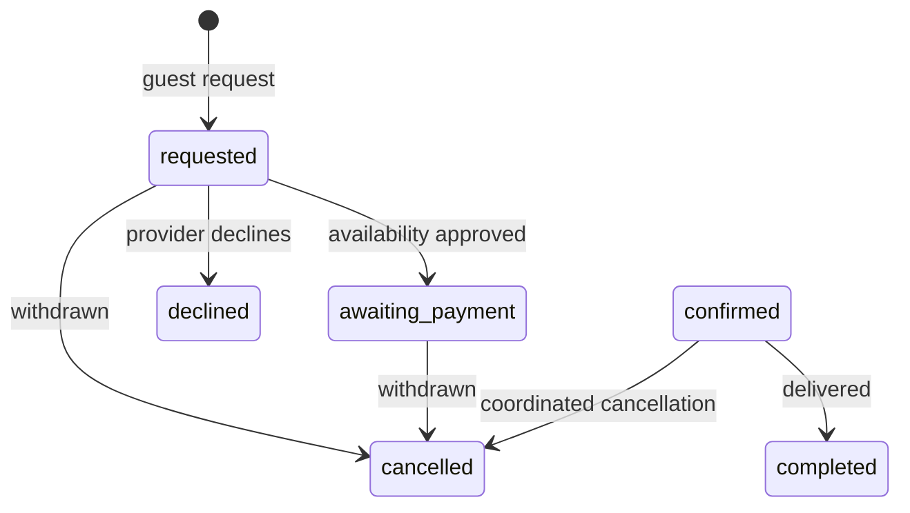

# Implemented architecture: Atlas Journeys

Updated 21 October 2026, following the user's explicit stack choice. The PostgreSQL proposal is archived in `architecture-postgres-proposal.md`; `schema.sql` is historical research, not app setup.

## Stack

Next.js 16 App Router, React 19, TypeScript, Tailwind CSS 4, and the official MongoDB driver. Server pages render discovery/detail content; client components provide forms and workspaces. SWR revalidates data using user-scoped cache keys. Authentication transitions reset client caches. Original tokens live in `design/tokens.css`; responsive layouts in `src/app/globals.css`. Lucide supplies icons; independently sourced photographs are served locally.

Development can start a persistent WiredTiger MongoDB process. Production requires an explicit URI and never auto-seeds samples. No Supabase, Drizzle, Postgres, or payment SDK is used.

## Routes

| Surface | Routes |
| --- | --- |
| Traveler | `/`, `/explore?category=&city=&start=&end=`, `/experiences/[id]` |
| Guest | `/booking/[id]` with fragment capability exchanged for HttpOnly cookie |
| Assistance | `/support`, `/partners`, `/policies/[slug]` |
| Staff | `/login` |
| Agency | `/agency`, `/agency/bookings`, `/agency/fleet`, `/agency/calendar`, `/agency/settings` |
| Platform | `/platform`, `/platform/bookings`, `/platform/agencies`, `/platform/listings`, `/platform/calendar`, `/platform/support`, `/platform/settings` |
| Internal | `/design`, development only |

## Collections and authorization

`users` (unique email/ID, salted hashes), `agencies` (unique ID, approval state), `listings` (unique ID, owner, cents price, visibility), `bookings` (unique reference/idempotency key, agency/start index, snapshots, capability hash/expiry), `tickets`, `audit`, and `limits` (atomic counters and TTL).

Every workspace operation verifies the signed session, current staff record, role, agency status, and record ownership. Password hashes and capability hashes never enter workspace responses. Client-supplied agency IDs cannot authorize an agency action. Public catalog queries require a published listing and active provider.

## Request state and price

There is no implemented `awaiting_payment → confirmed` action. It requires a future verified-payment and resource allocation workflow. Seeded confirmed/completed records are fictional examples only.

Cars use calendar-date duration, integer-cent daily prices, chosen cover, and seat quantity. Activities multiply guests; drivers and boats use per-trip quotes. Deposits are separate. The server validates dates, exact driver age/licence anniversary, provider status, and quantities. Unique request keys and payload fingerprints prevent duplicate creation. Capability material is derived from the random request key and the server secret; its hash and a 30-day expiry are retained.

Implemented: discovery → request → agency review → guest management, full partner application/private registration-document storage, platform agency onboarding, support, original guides and FAQs, with English/French/Arabic localization. Financial fulfillment, resource locking, email, automated recovery, and operating agreements remain launch work. See `backend.md`, `features.csv`, and `test-plan.md`.

Language is resolved server-side from an allowlisted preference cookie or browser language. A shared client context receives only the active dictionary; refreshing translated server content preserves form state and stable URLs. Root language/direction, metadata, formats, CSV headings, and RTL layouts follow the active locale. See `localization.md`.

## Agency rental contracts (30 October 2026)

Contracts are a dedicated agency-only surface at /agency/contracts, backed by /api/contracts and contracts/contract_counters collections. Documents reference owned contacts, physical vehicles and optional car reservations/invoices. Server validation checks related-record ownership and invoice/customer/currency compatibility. Draft saves capture party/vehicle/price/terms snapshots. Issuing gives a unique per-agency/year reference and locks the agreement. Issued records can append a return record, or be voided; returned/void records cannot be revived. Optimistic versions guard every update. Prices use integer cents and calendar-date billing, with refundable deposits excluded from the total. No inventory allocation, payment or e-signature side effect is implied.
